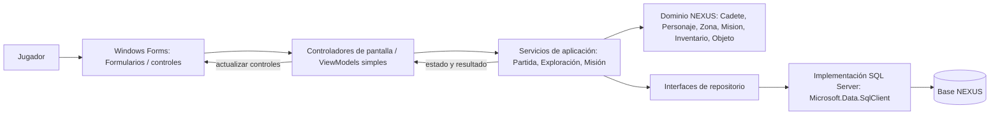

# Arquitectura propuesta

## Objetivo

Sustituir gradualmente el acoplamiento de consola de `SistemaNexus` por una interfaz gráfica que use los mismos conceptos y reglas de H3. WinForms debe dibujar y recoger acciones; el dominio decide si son válidas; la persistencia almacena/recupera una instantánea coherente. SQL Server no debe ser consultado directamente desde los formularios.

## Diagrama

## Capas y relación con archivos reales

1. **Presentación — `NEXUS.windowsforms/`**. `Form1` actual contiene `StartSimulation`, `ShowMaps` y otros manejadores. En la siguiente fase, reemplazar el lanzamiento de consola por comandos de aplicación y pantallas integradas: `MainMenuForm`, `ExplorationForm`, `MissionForm`, `ExplorerInventoryForm`. El Designer define distribución y eventos solamente; no aplica costos ni altera la misión.
2. **Aplicación — proyecto nuevo `NEXUS.Application/` o carpeta equivalente**. Servicios como `ExplorationService`, `EncounterService`, `MissionService` y `SaveGameService` coordinan casos de uso. Validan comandos, llaman reglas del dominio, guardan cambios y devuelven resultados para mostrar. Usar interfaces (`IGameRepository`) para desacoplar SQL; DI con Generic Host es opcional al crecer el número de dependencias.
3. **Dominio — proyecto nuevo `NEXUS.Domain/`**. Extraer de `Program.cs` `Personaje`, `Cadete`, `Robot`, `Enemigo`, `Objeto`, `Inventario`, `Zona` y `Mision`. Cambiar salida `Console.WriteLine` por resultados/eventos de dominio, validar límites de energía/vida y representar estado de misión de modo explícito. Mantener namespace y API estables durante migración para evitar reescribir reglas sin necesidad.
4. **Datos — proyecto `NEXUS.Infrastructure/`**. Implementar repositorios SQL Server y mapeos para cargar/guardar partida, inventario y progreso de objetivos. Abrir conexión por operación con `Microsoft.Data.SqlClient`, comandos parametrizados y transacciones cuando se guarda un conjunto de entidades.
5. **Composición — `NEXUS.windowsforms/Program.cs`**. Registrar servicios/repo, leer cadena de conexión de configuración segura y construir formularios. El arranque actual abre directamente `Form1`; no debe incrustar reglas ahí.

## Flujo de una acción

El jugador pulsa una zona en el mapa. El formulario envía `ExploreZoneCommand(zoneId)` al servicio; el servicio verifica estado/energía y llama a las reglas extraídas de `SistemaNexus`. El dominio devuelve evento, cambios de estado y objetivos; el servicio persiste la partida. La vista recibe resultado y actualiza mapa, barra de estado, inventario y log. Si la persistencia falla, el servicio no debe informar un guardado exitoso y la pantalla conserva el estado en memoria con mensaje recuperable.

## Decisiones de implementación

- Separar reglas de interfaz antes de añadir SQL: facilita probar y reusar el dominio en consola durante la transición.
- Definir claves estables (`CadeteId`, `ZonaId`, `MisionId`) en lugar de persistir nombres visibles como identidad.
- Mantener UI en el hilo principal; las operaciones de datos serán asíncronas si se percibe espera, con controles deshabilitados temporalmente para evitar dobles acciones.
- No almacenar la cadena SQL en Git. Configurarla en ambiente local / secreto de usuario, con mínimos permisos para la base.
- No introducir un motor 3D ni migrar a una tecnología de otra plataforma: el alcance requiere WinForms de escritorio Windows.
