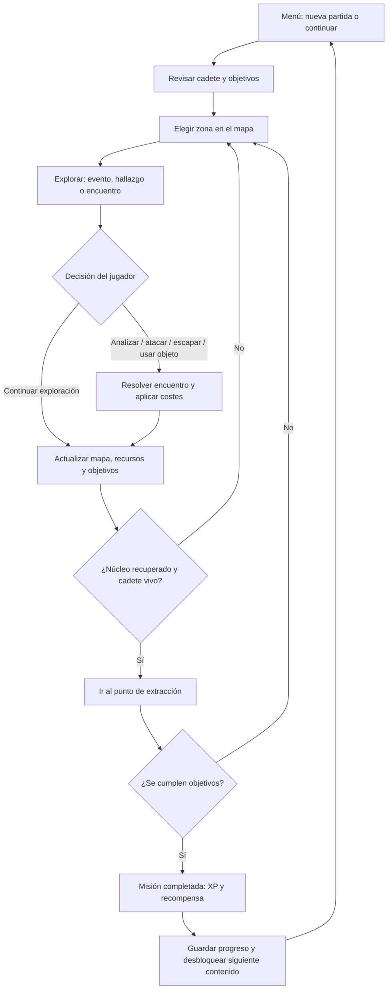

# Diseño del juego — NEXUS

## Visión

NEXUS será una aventura gráfica de exploración y supervivencia en una realidad alterada. El jugador asume el rol de un cadete de IRIS y decide cómo administrar energía, vida y equipo mientras investiga una anomalía. La tensión nace de elegir entre avanzar hacia el objetivo, prepararse en una zona conocida o retirarse a extracción. Cada acción debe mostrar sus consecuencias y acercar al jugador a completar la misión «La anomalía perdida».

La versión final conserva el argumento y las entidades de H3: Cadete, Robot, Enemigo, Objeto, Inventario, Zona, Mision y SistemaNexus. La interfaz gráfica reemplazará la navegación por consola; no se presume que el prototipo de menú actual ya implemente el juego completo.

## Ciclo principal



Una sesión comienza al crear o cargar al cadete. Desde el mapa se selecciona una zona; la exploración actualiza recursos, inventario y objetivos y puede disparar un encuentro. Tras resolverlo, el jugador revisa el estado y decide volver al mapa o dirigirse a extracción. La misión solo se completa al reunir las condiciones definidas y regresar con vida. Al terminar, se entrega experiencia y recompensa y se guarda el progreso.

## Mecánicas y reglas

| Sistema | Base H3 | Evolución jugable |
|---|---|---|
| Explorador | `Cadete`: vida inicial 100, energía 60, experiencia 0 e inventario. | Panel persistente con barras y valores numéricos; energía y vida nunca bajan de 0 y energía no supera 100. XP y estado se conservan al guardar. |
| Mapa y zonas | `SistemaNexus` crea Bosque de Cristal, Ruinas de IRIS, Zona de Anomalía y Punto de Extracción. | Mapa seleccionable con descripción, estado y coste/riesgo visible antes de confirmar. El Bosque entrega célula y 10 XP y cuesta 5 energía; Anomalía cuesta 10. Evitar repetir hallazgos de misión ya consumidos sin una regla explícita. |
| Encuentros | `Robot` y `Enemigo` heredan de `Personaje`; opciones: atacar, escapar, utilizar objeto o analizar. | Diálogo de encuentro con acciones disponibles, condición y resultado legibles. En H3 el ataque inflige 50; el robot puede infligir 10 de daño y gastar 5 de energía, el enemigo 15 de daño. Escape cuesta 10 de energía. Persistir salud del encuentro si el jugador puede salir y volver. |
| Misión | `Mision` «La anomalía perdida»: llegar a anomalía, encontrar núcleo, sobrevivir y regresar. | Lista de objetivos con estados pendientes/completados y notificación al actualizar. Extracción se habilita solo con anomalía visitada, núcleo encontrado, supervivencia y vida mayor a cero. |
| Inventario | `Inventario` almacena objetos por nombre/tipo/poder; usar retira el objeto. | Lista seleccionable con efecto, cantidad y confirmación cuando corresponda. Célula restaura hasta el límite de energía; escudo/ataque/analizador en H3 solo muestran mensajes, así que su efecto de juego debe definirse antes de implementarlo. |
| Progresión | H3 suma 25 XP al derrotar, 30 XP al hallar núcleo y 100 XP al completar; da módulo desconocido. | Conservar estos hitos al inicio, evitar otorgar recompensa más de una vez, y definir niveles/desbloqueos en una iteración posterior. |

Los números describen el comportamiento que se observa en `Program.cs`; cualquier balance distinto debe quedar registrado como decisión de diseño al implementarse.

## Pantallas y navegación

Los wireframes son funcionales como guía, no representan controles ya implementados. En la interfaz final, las vistas internas comparten barra superior de estado y navegación consistente. Menú → partida/mapa; mapa → detalle de zona → evento/encuentro; navegación secundaria → Misiones o Exploradores/Inventario; extracción → resumen → menú o siguiente misión. Escape vuelve a la vista anterior salvo durante una acción confirmada.

### 1. Menú principal

```text
┌────────────────────────────── NEXUS // IRIS ──────────────────────────────┐
│                                                                           │
│             [ Arte: portal / anomalía ]        NEXUS                      │
│                                               Sistema de inmersión         │
│                                               [ Nueva partida ]           │
│                                               [ Continuar ]               │
│                                               [ Archivos / opciones ]     │
│                                               [ Salir ]                   │
└───────────────────────────────────────────────────────────────────────────┘
```

Presenta identidad, fondo ilustrado, acción principal destacada y acceso a continuar, opciones y salida. `Continuar` solo aparece activo si existe partida guardada.

### 2. Exploración / mapa

```text
┌ NEXUS ─ Cadete: Aki ─ Vida ███████ 80 ─ Energía █████ 55 ─ XP 40 ──────┐
│ MAPA DE REALIDADES                       │ REGISTRO / ZONA SELECCIONADA   │
│                                         │ Bosque de Cristal               │
│ [Bosque] ─── [Ruinas] ─── [Anomalía]    │ Señales energéticas. Riesgo bajo│
│     └────────────── [Extracción]         │ Coste estimado: 5 energía       │
│                                         │ [Explorar zona]                 │
│ [Mapa] [Misiones] [Exploradores/equipo] │ Último evento: célula +10 XP    │
└───────────────────────────────────────────────────────────────────────────┘
```

Muestra estado siempre visible, zonas y conectividad, detalle de selección, coste/riesgo antes de actuar y registro reciente. Las acciones no disponibles deben explicar el requisito.

### 3. Misiones

```text
┌ NEXUS ─ Vida 80 ─ Energía 55 ─ XP 40 ────────────────────────────────────┐
│ MISIÓN ACTIVA: La anomalía perdida          [Progreso 2/4]                 │
│ [✓] Llegar a la zona de anomalía                                          │
│ [✓] Encontrar el núcleo energético                                        │
│ [ ] Sobrevivir al encuentro                                               │
│ [ ] Regresar al punto de extracción                                       │
│ Recompensa: 100 XP + módulo desconocido                                   │
│                                      [Ir al mapa] [Volver]                 │
└───────────────────────────────────────────────────────────────────────────┘
```

Objetivos y recompensas visibles, con actualización inmediata y señal textual además de color.

### 4. Exploradores / inventario

```text
┌ NEXUS ─ Exploradores y equipo ────────────────────────────────────────────┐
│ [Cadete Aki] [Robot aliado: bloqueado] │ VIDA 80/100  ENERGÍA 55/100 XP 40│
│                                        │ Inventario                       │
│ Perfil: Cadete IRIS                    │ • Célula de energía  +25         │
│ [Retrato] Estado: operativo             │ • Escudo portátil    +20         │
│                                        │ • Analizador          uso         │
│                                        │ [Usar seleccionado] [Volver]     │
└───────────────────────────────────────────────────────────────────────────┘
```

La pestaña de exploradores presenta perfil y condición; el panel de inventario describe tipo y efecto y pide confirmación si el objeto se consume. En H3 no existe gestión de un grupo: cualquier miembro adicional es una ampliación futura, no un dato actual.

## Experiencia de usuario

- **Legibilidad:** tipografía de interfaz ≥ 12 pt en la escala base, contraste alto y texto breve; no codificar estados solo mediante color.
- **Jerarquía:** primero objetivo/acción primaria, luego estado del cadete, contexto de zona y registro secundario.
- **Consistencia:** misma ubicación para navegación, confirmación y retroceso; iconos acompañados por etiquetas.
- **Navegación:** acciones principales accesibles con mouse y teclado, foco visible, orden de tabulación lógico y confirmación para salir/consumir recursos importantes.
- **Retroalimentación:** comunicar coste antes de explorar, resultado y cambio de atributos inmediatamente después; mostrar error junto al control y conservar el estado ante fallos de guardado.
- **Ritmo:** una acción del jugador produce un resultado comprensible y permite volver al mapa sin diálogos modales repetitivos.

## Alcance y restricciones

**Prioridad de primera versión gráfica:** integrar el modelo Cadete/Mision/Zona/Inventario existente en lógica independiente de la UI; menú y mapa; exploración de las cuatro zonas; encuentro sencillo; objetivos y extracción; guardar/cargar una partida local SQL Server; errores de conexión comprensibles.

**Opcional después:** múltiples misiones, niveles y desbloqueos, aliados controlables, animaciones, audio, editor de mapas, sincronización entre equipos, multijugador y soporte multiplataforma.

**Restricciones:** aplicación de escritorio C# Windows Forms sobre Windows; SQL Server como persistencia propuesta. No convertir H3 en un juego distinto ni afirmar que la UI actual o la base de datos ya implementan el flujo final. Mantener viable la ejecución de consola mientras se migra gradualmente. No almacenar contraseñas ni secretos en el repositorio. Definir decisiones de balance y reglas faltantes (reintentos, uso real de escudo/ataque/analizador, duplicación de objetos) antes de codificar.
