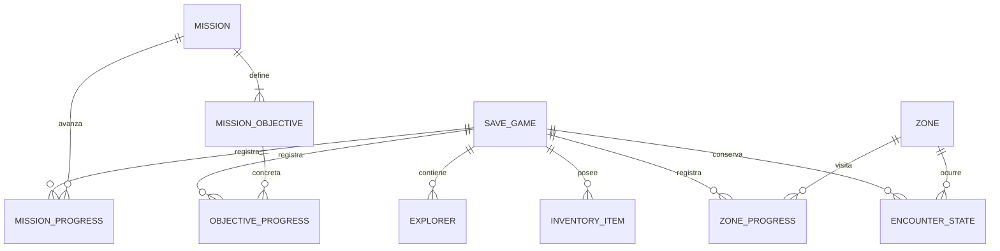

# Modelo de datos propuesto — SQL Server

## Alcance y mapeo desde H3

El modelo conserva el estado que ya existe en `Cadete` (vida, energía, XP), `Inventario`/`Objeto`, `Mision` (cuatro objetivos booleanos), `Zona` y los tipos de `Personaje`. `SistemaNexus` deja de ser dueño del estado global y pasa a coordinar casos de uso. Los nombres y descripciones visibles permanecen editables; claves numéricas/UUID identifican filas.

## Entidades

| Tabla | Campos principales | Relación / motivo |
|---|---|---|
| `SaveGame` | `SaveGameId` PK, `Name`, `CreatedAt`, `UpdatedAt`, `SchemaVersion` | Una ranura de partida; versión facilita migraciones. |
| `Explorer` | `ExplorerId` PK, `SaveGameId` FK, `Name`, `Health`, `Energy`, `Experience` | Un cadete por ranura en el alcance inicial; campos derivan de `Cadete`. Checks: vida/energía 0–100 y XP ≥ 0. |
| `Zone` | `ZoneId` PK, `Code` UNIQUE, `Name`, `Description`, `SortOrder` | Catálogo de Bosque, Ruinas, Anomalía y Extracción; evita usar texto como clave. |
| `Mission` | `MissionId` PK, `Code` UNIQUE, `Name`, `Description` | Catálogo de «La anomalía perdida». |
| `MissionProgress` | `SaveGameId` FK, `MissionId` FK, `Status`, `StartedAt`, `CompletedAt`; PK compuesta | Estado de misión para una partida; ampliable a varias misiones. |
| `MissionObjective` | `ObjectiveId` PK, `MissionId` FK, `Code`, `Description`, `SortOrder`, UNIQUE(`MissionId`,`Code`) | Catálogo de cuatro objetivos. |
| `ObjectiveProgress` | `SaveGameId`, `ObjectiveId`, `IsComplete`, `CompletedAt`; PK compuesta y FKs | Conserva estados que ahora son booleanos en `Mision`. |
| `InventoryItem` | `InventoryItemId` PK, `SaveGameId` FK, `Name`, `Type`, `Power`, `Quantity` | Instancias apilables de los objetos iniciales y recompensas; cantidad positiva. En primera fase puede permanecer cantidad 1. |
| `ZoneProgress` | `SaveGameId` FK, `ZoneId` FK, `Visited`, `VisitCount`, `LastVisitedAt`; PK compuesta | Reemplaza la ausencia de visita/estado de zona; permite evitar recompensas repetidas. |
| `EncounterState` (opcional) | `EncounterStateId` PK, `SaveGameId` FK, `ZoneId` FK, `EnemyCode`, `Health`, `Status` | Solo necesaria si encuentros continúan entre visitas o se guardan a mitad de combate. |

`SaveGame` 1:N `Explorer`, `MissionProgress`, `InventoryItem` y `ZoneProgress`; `Mission` 1:N `MissionObjective`; progreso de objetivos conecta partida con objetivo; `Zone` se referencia desde progreso de zona y encuentros. Puede imponerse unicidad de un cadete principal por partida si se desea el modelo inicial estrictamente de un explorador.

## Diagrama entidad-relación

La tabla de progreso de objetivos debería incluir clave foránea compuesta hacia `MissionProgress` o incluir `MissionId` para garantizar que el objetivo pertenece a una misión activa en esa partida. Es una restricción de integridad que debe cerrarse al escribir el DDL.

## Guardar y cargar

1. `SaveGameRepository.Load(saveGameId)` carga en una transacción/consultas coordinadas ranura, cadete, progreso, inventario y zonas; ensambla el modelo de dominio.
2. Al completar una acción válida, la aplicación actualiza el modelo y ejecuta `SaveGameRepository.Save(snapshot)` en transacción: actualizar explorer, sincronizar inventario, objetivos, misión y zonas, y marcar `UpdatedAt` solo al confirmar.
3. Para guardar cada acción, una transacción garantiza que energía gastada y recompensa/inventario no queden a medias. Para frecuencia mayor, guardar al volver al mapa y al completar hitos, con indicación clara de último guardado.
4. Todos los valores de usuario se envían como parámetros SQL tipados; conexiones se configuran fuera del repositorio. No se guardan binarios de imágenes ni secretos en SQL para este alcance.
5. Ante fallo, rollback y comunicar que el progreso actual no quedó guardado; permitir reintento. Las migraciones de esquema incrementan `SchemaVersion` y conservan una copia de seguridad antes de cambios incompatibles.

En H3 no hay persistencia, identificadores estables ni varias ranuras: estas tablas son propuesta, no describen una base implementada.
